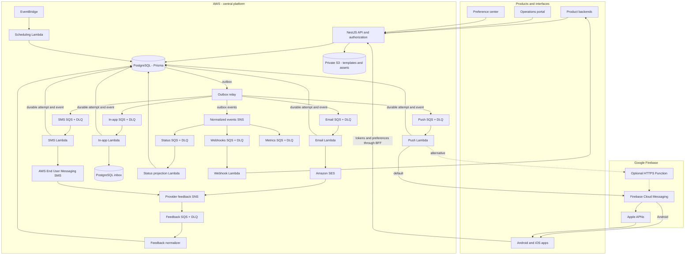
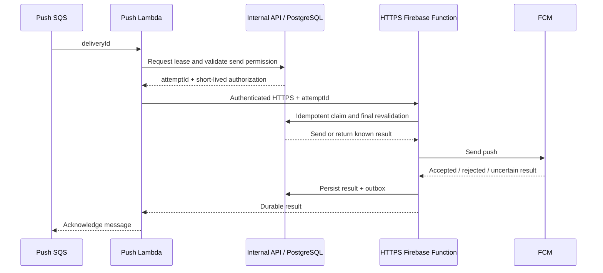
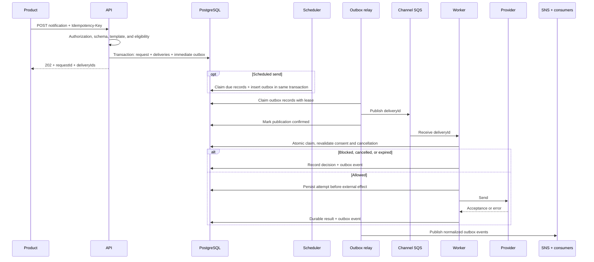
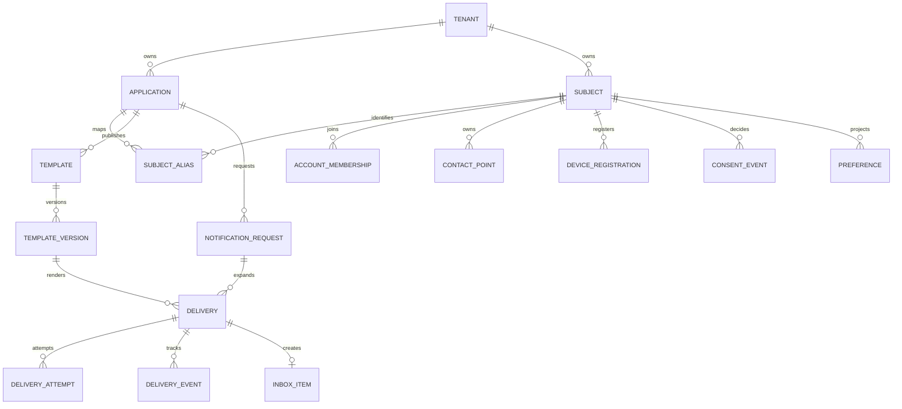

# realmanage-notify

Shared communication platform proposal for RealManage, CiraNet, and other products.

**Status:** architecture and product proposal; no implementation or infrastructure provisioned.  
**Date:** October 21, 2026.  
**Research reviewed:** October 21, 2026. Recommendations distinguish documented service behavior from proposed RealManage engineering choices.  
**Platform direction:** Firebase Cloud Messaging (FCM) as the primary push provider, with Firebase Functions as an execution option; AWS remains responsible for orchestration, persistence, email, and SMS.

## 1. Objective and proposed decisions

Build a central service that receives communication requests from business systems, applies preferences and consent, selects published templates, and delivers email, SMS, push, or notifications inside the product. An operations portal manages the service, and each user has a preference center.

Products supply **the event, recipient, and variables**. realmanage-notify determines **how, when, through which channel, and whether the communication may be sent**. Source systems retain ownership of business data and authorization to access accounts and communities.

Initial decisions:

- Build on NestJS/TypeScript, Prisma/PostgreSQL, S3, SQS, SNS, Lambda, and EventBridge, with Firebase Cloud Messaging for mobile push.
- Keep PostgreSQL as the source of truth for requests, preferences, published templates, attempts, and audit records.
- Use Amazon SES for email; add a SendGrid adapter only if a product has a confirmed requirement for it.
- Use AWS End User Messaging SMS for SMS. SNS remains the event bus; its direct SMS sending capability is not required.
- Use FCM for Android and iOS push; iOS delivery still passes through APNs.
- Initially run the FCM adapter in Lambda. An HTTPS Firebase Function can serve as the sending bridge without introducing another queue or scheduler.
- Build a React/TypeScript portal and preference APIs that applications can reuse.
- Introduce a transactional outbox, idempotency, and opt-out checks at send time.
- Separate requests, channel deliveries, attempts, and provider events. “Accepted” does not mean “delivered” or “read.”

This is a standalone RealManage service design. Its API, data model, permissions, deployment, and operating procedures are owned by the platform team. A consumer integrates through published contracts rather than sharing implementation details or database credentials.

## 2. Product scope and design approach

### Required capabilities

1. Product, tenant, user, and business-account identity with isolation across applications.
2. Immediate and scheduled email, SMS, FCM push, and in-app delivery, with independent workers and failure handling.
3. An operations portal for template creation/upload, preview, review, publication, recipients, and delivery monitoring.
4. A user preference center and staff workflows for consent, opt-out, suppression, and evidence-backed reactivation.
5. Durable commands/events, auditable attempts, cancellation, reconciliation, and protection against unintended resends.
6. Versioned APIs, application onboarding, reusable SDKs, and signed result webhooks.

### Architecture approach

Start with a modular NestJS API, shared domain packages, and independently deployed workers where queue isolation provides operational value. Do not create a network service for every module. Separate the control plane—templates, policies, preferences, and application administration—from delivery execution, while retaining one authoritative transactional store for business state.

Assess the design through operational excellence, security, reliability, performance efficiency, cost optimization, and sustainability. For this proposal, those concerns translate into runbooks, tenant isolation, durable delivery, bounded concurrency, measured capacity, and eliminating unnecessary polling/duplicate work. This is a review approach, not a certification claim. [AWS Well-Architected Framework](https://docs.aws.amazon.com/wellarchitected/latest/framework/welcome.html).

### Evidence and assumptions

Service guarantees and protocol requirements are cited next to the relevant decisions. Values such as the 30-day scheduling window, retention periods, poll interval, and latency targets are proposed product settings; they are not universal industry requirements or measured production results. Validate them against traffic, geography, budget, and operational capacity before launch.

The initial design assumes a primary AWS Region, a managed PostgreSQL deployment, a corporate identity provider, and separate production/nonproduction Firebase projects. Establish recovery objectives and residency requirements before committing to regional topology. Select supported runtime and database versions at implementation time and pin them in infrastructure and build configuration.

## 3. Concepts and ownership boundaries

A **tenant** is the administrative and data-isolation boundary. An **application** is an integrated product, such as `ciranet-community`, `resident-web`, or `staff-portal`. A **business account** represents a resident, property, or association account in the source system; it is not an AWS account. A **user** is the authenticated person. One person may belong to multiple accounts and products.

The exact meaning of tenant—company, managed organization, or another unit—must be settled before migrations. Do not assume every community is a tenant; communities may be business scopes within a tenant.

An external identity is mapped by `(tenantId, applicationId, externalUserId)`. Do not merge people merely because they share a phone number or email address. An address may belong to a shared mailbox or may have been reassigned.

One person's preferences do not automatically change those of other account members. An administrator may suspend communications for an account or tenant but cannot declare consent for every resident. Treat a shared corporate contact as its own recipient, with an accountable owner and supporting evidence.

Outside the initial scope: marketing journey builders, CRM, complex campaign segmentation, product billing, replacement of the identity provider, and chat-platform automation. Integrate additional channels only when a concrete product requirement justifies them.

## 4. Architecture



The diagram shows two push options: choose **only one per application/environment**. Firebase Functions does not consume SQS natively in this design; Lambda makes the HTTPS call when that option is enabled.

Command queues are separate from event queues. Each SNS consumer has its own SQS queue and DLQ; consumers with different responsibilities do not compete for messages in the same queue. Permissions restrict subscriptions to authorized tenants/products when external consumers are involved.

A dedicated status projector maintains queryable delivery summaries. The worker must persist the attempt and a minimal durable result before acknowledging the SQS message; deduplication and resend decisions cannot depend solely on a delayed asynchronous projection.

### Infrastructure and execution

- API: a NestJS container, with ECS/Fargate as the initial deployment recommendation. Use Helm on an existing corporate Kubernetes platform if that is the approved operating standard; do not introduce a new cluster solely for this service.
- PostgreSQL: RDS PostgreSQL or Aurora PostgreSQL, selected according to operational needs and load. Use Prisma schemas/migrations and connection pooling sized for Lambda concurrency.
- Portal: React/TypeScript hosted on private S3 + CloudFront, with corporate authentication. Deploy the portal independently of workers, using the same versioned API contracts as product integrations.
- Templates: private, versioned S3; metadata, publication state, and permissions in the database.
- Scheduler: EventBridge Scheduler invokes Lambda at a configurable one-minute interval; PostgreSQL remains the scheduling authority. This is minute-level orchestration, not a real-time timer. AWS documents 60-second invocation precision for EventBridge Scheduler. [Schedule behavior](https://docs.aws.amazon.com/scheduler/latest/UserGuide/schedule-types.html).
- Outbox relay: a continuously running process on the container infrastructure, scalable and using leases, to avoid adding a minute of latency to immediate sends; a periodic Lambda can recover pending work.
- Infrastructure as code: Terraform in the approved infrastructure repository. Separate environments, queues, topics, keys, and Firebase projects for development, QA, and production.

## 5. Channels

### Email

Use SES by default; a product-specific SendGrid adapter can implement the same provider contract if required. Register and verify domains/senders per application; do not accept arbitrary client-supplied `from` addresses.

Each send includes the correct configuration set, correlation identifiers, and template versions. Delivery, bounce, and complaint events enter through the feedback pipeline. Configuring SES event publishing is part of provisioning; a successful send API call confirms only acceptance. [SES event publishing](https://docs.aws.amazon.com/ses/latest/dg/monitor-sending-using-event-publishing-setup.html), [event types](https://docs.aws.amazon.com/ses/latest/dg/event-publishing-retrieving-sns-examples.html).

The proposal includes plain-text alternatives, preference links, and unsubscribe links for optional categories. Hard bounces and complaints create suppressions, respecting the scope of the provider identity/account. Do not switch providers to bypass a suppression.

### Email authentication and reputation

Treat verified sending identity, SPF/DKIM configuration, DMARC alignment, and TLS as launch requirements. Keep optional/bulk and operational traffic distinguishable through approved sender configuration and metrics so a campaign cannot silently damage all product communications. Check the actual receiving-provider requirements for the intended traffic, including Google's additional requirements for high-volume senders; do not treat one mailbox provider's policy as a universal legal rule. [Google email sender guidelines](https://support.google.com/mail/answer/81126?hl=en).

One-click unsubscribe must be tested on an actual message received through SES, including the signed headers, rather than inferred from template HTML. Track bounce/complaint trends by application and sender, and define a pause threshold and accountable owner before production.

### SMS

Use AWS End User Messaging SMS with `SendTextMessage`, an origination identity, and a configuration set defined in the application configuration. Include `deliveryId` in the correlation context. Numbers/senders and approvals appropriate to the destination countries must be in place before production. [Sending API](https://docs.aws.amazon.com/pinpoint/latest/apireference_smsvoicev2/API_SendTextMessage.html).

Keep provider-managed automatic opt-outs enabled in the MVP. Do not enable self-managed opt-outs without implementing and testing full responsibility for STOP/HELP handling and responses. Provider blocks take precedence over any positive portal preference. [Opt-out lists](https://docs.aws.amazon.com/sms-voice/latest/userguide/opt-out-list.html), [self-managed opt-outs](https://docs.aws.amazon.com/sms-voice/latest/userguide/opt-out-list-self-managed.html).

Receive feedback through configuration set → SNS → SQS. Carrier receipts may be delayed or unknown; a missing receipt is not an automatic reason to resend. [Event destinations](https://docs.aws.amazon.com/sms-voice/latest/userguide/configuration-sets-event-destinations.html).

Show encoding, estimated segment count, and relative cost in the preview. Configure limits per tenant, country, and time period to control volume.

### Push with Firebase Cloud Messaging

**Proposed default:** `Push SQS → Push Lambda → FCM HTTP v1 → Android / APNs → iOS`. The service obtains server-to-server authorization; sending credentials never reach the app or portal. [FCM HTTP v1](https://firebase.google.com/docs/cloud-messaging/send/v1-api).

Register the Firebase project, native application, environment, and sending credentials on the server. For iOS, configure the APNs key and the association between APNs and FCM tokens. Expo, APNs, and FCM tokens are different formats and are not interchangeable. [FCM for Apple](https://firebase.google.com/docs/cloud-messaging/ios/get-started).

Each authenticated installation registers `installationId`, `fcmToken`, `platform`, `applicationId`, environment, and the observed OS permission state. Associate it with the authenticated user; update the registration when the token rotates, deactivate the association on logout, and remove invalid tokens based on FCM responses. [Token management](https://firebase.google.com/docs/cloud-messaging/manage-tokens).

Push payloads contain generic text, `notificationId`, `deliveryId`, TTL, and an allowed navigation reference. Financial data, personal data, and account content are loaded through the product API after authentication. The app must not automatically display sensitive content from a payload received for an earlier session.

Do not use FCM topics as an authorization mechanism for personal or restricted-community messages. Resolve authorized tokens in the backend. OS permission does not replace category opt-in, and the portal cannot grant OS permission on the user's behalf.

The ID returned by FCM represents acceptance. This design does not assume a universal FCM webhook providing delivery/read status for every device. Authenticated open events can feed telemetry without equating “opened” with “read.”

### FCM throttling, freshness, and retries

Rate-limit by Firebase project and application; smooth large fan-outs instead of exhausting quota in bursts. Honor `Retry-After` on `429` responses, apply bounded exponential backoff with jitter to eligible transient failures, and stop retrying expired work. Invalid payloads, credentials, and permissions require correction rather than blind retries. Make the adapter classify provider responses explicitly; a network timeout can still have an unknown outcome and follows the reconciliation rule in Section 6. [FCM scaling guidance](https://firebase.google.com/docs/cloud-messaging/scale-fcm).

Derive Android TTL and APNs expiration from the remaining business lifetime, subject to provider limits. Do not leave obsolete maintenance alerts or expired reminders waiting for an offline device. Collapse only updates that the product explicitly declares replaceable; distinct business events remain distinct. These are application freshness choices informed by the provider's delivery lifetime behavior. [FCM message lifespan](https://firebase.google.com/docs/cloud-messaging/customize-messages/setting-message-lifespan).

### Where Firebase Functions fits

A second-generation HTTPS Function can serve as the sending adapter:



The Function only sends and persists results through a restricted internal API. It does not maintain another consent copy, schedule work, or use Firestore as a second ledger. If it cannot record the result after calling FCM, the attempt enters reconciliation; an HTTP retry must not blindly trigger another send.

Protect the Function with invocation IAM, an ID token whose audience matches the endpoint, and an authorized service identity; do not expose a public `onRequest` endpoint secured only by a static key in the body. The internal API also authenticates the Function and limits its actions to the authorized attempt. [HTTP Functions](https://firebase.google.com/docs/functions/http-events), [service-to-service authentication](https://docs.cloud.google.com/run/docs/authenticating/service-to-service).

Prefer Workload Identity Federation for temporary credentials between AWS and Google, validating the chosen library/runtime in a proof of concept. If a service-account secret is needed during transition, store it in Secrets Manager with minimal scope, rotation, and a retirement plan; never in Git. [Workload Identity Federation](https://docs.cloud.google.com/iam/docs/workload-identity-federation).

**Recommended MVP choice:** Lambda calls FCM directly, because this keeps queue processing, retry ownership, and observability in the chosen AWS orchestration layer. Adopt the Function if the Firebase team owns adapter operations. An alternative with orchestration entirely in AWS is SNS Mobile Push, which uses APNs/FCM as delivery networks; do not run SNS and direct FCM for the same delivery. [SNS Mobile Push](https://docs.aws.amazon.com/sns/latest/dg/sns-mobile-application-as-subscriber.html).

### In-app

Create persistent inbox records accessible through authenticated APIs, with pagination, an unread count, and read marking. Polling is sufficient for the MVP; SSE/WebSocket can follow.

In-app is an explicit channel in the business request, not an automatic side effect of “email delivered.” A user may receive only in-app, only push, or both. An email outage does not prevent inbox creation. Revoking community access also restricts access to historical messages associated with that community.

## 6. Reliable flow: immediate sends, scheduling, and cancellation



### Consistency and idempotency

Save the request, deliveries, and publication intent in the same transaction. The outbox closes the database/queue failure window; the relay may publish more than once if it crashes after SQS accepts a message. Every worker therefore needs deduplication and a claim keyed by `deliveryId`. [Transactional outbox](https://docs.aws.amazon.com/prescriptive-guidance/latest/cloud-design-patterns/transactional-outbox.html).

Initially use SQS Standard with at-least-once processing, `ReportBatchItemFailures`, a visibility timeout appropriate to the total processing time, and concurrency bounded by provider and database capacity. FIFO does not make an external send exactly once. [Lambda with SQS](https://docs.aws.amazon.com/lambda/latest/dg/with-sqs.html), [partial failures](https://docs.aws.amazon.com/lambda/latest/dg/services-sqs-errorhandling.html).

`Idempotency-Key` is required when creating requests and is unique per tenant and application. The same key and payload hash return the previous result; different content returns `409`. Deduplication retention must cover the scheduled period and every authorized replay; the initial proposal is 90 days, subject to retention approval.

Before each external call, create a `delivery_attempt` with a lease, fencing token, and `sending` state. Duplicate claims do not send. **There is no absolute exactly-once guarantee at the provider:** if it accepts a request and the response is lost, record `unknown` and reconcile where possible. Without proof that no send occurred, do not switch providers or automatically resend. An expired lease in `sending` requires reconciliation rather than an immediate new attempt.

If sending is already confirmed and only SNS fails, retry outbox publication, never the send. Transient errors known not to have resulted in acceptance receive retries with backoff and jitter; permanent errors end the attempt. Invalid or poison messages go to a DLQ. Do not publish terminal `failed` while a valid retry remains pending.

### Queue configuration and recovery

- Configure the Lambda event source mapping for partial batch responses, not just the handler return shape. Set source-queue visibility timeout to at least six times the Lambda timeout; account for any batching window and the measured processing budget. Start with `maxReceiveCount` of at least five and validate under throttling. These follow AWS guidance, while actual timeouts and concurrency remain workload-specific. [SQS event source configuration](https://docs.aws.amazon.com/lambda/latest/dg/services-sqs-configure.html).
- Use a DLQ retention period longer than its source queue. Standard-queue message expiration retains the original enqueue timestamp, so time spent in the source queue reduces the remaining recovery window. Alert on DLQ arrivals and assign an owner. [SQS DLQ retention](https://docs.aws.amazon.com/AWSSimpleQueueService/latest/SQSDeveloperGuide/sqs-dead-letter-queues.html).
- Distinguish an SNS subscription delivery DLQ, which catches failures delivering an event into a subscriber queue, from a worker DLQ, which catches processing failures after successful queue delivery. Monitor both boundaries. [SNS subscription DLQs](https://docs.aws.amazon.com/sns/latest/dg/sns-dead-letter-queues.html).
- Durable delayed retries belong in the database with `nextAttemptAt` and an outbox command. After committing that retry decision, acknowledge the current SQS message. Unexpected processing failures can be retried by SQS; do not schedule another retry and also return that same record as failed.
- Count provider attempts separately from SQS receive count. Bound retries by attempt count and business expiration, and coordinate SDK retries with worker policy to prevent multiplicative retries.
- A recovery job identifies expired claims, overdue deliveries, unpublished outbox records, and missing feedback. It reconciles uncertain sends and requeues only work proven eligible, retaining the original delivery ID and current consent checks.

### Channel selection and business ordering

`channels` means requested independent fan-out, not an automatic fallback chain. Sending email, push, and in-app for one business event creates separate eligible deliveries and independent results. If fallback is introduced later, define an explicit policy, delay, cost limit, and consent check for the fallback channel; blocked SMS must not silently turn into an email campaign.

Queue ordering cannot guarantee useful business ordering. Include an optional source aggregate identifier and version, and define whether obsolete updates should be suppressed or delivered as history. A cancelled work order must not be followed by a stale “work started” alert simply because workers completed out of order. Use FIFO only where a measured ordering requirement justifies its trade-offs; retain domain version checks and provider reconciliation.

### Scheduling

- Initial maximum scheduling window of 30 days, proposed as a configurable product limit.
- Persist the UTC instant and selected IANA time zone; convert local times before accepting the request, explicitly handling ambiguous/nonexistent daylight-saving times.
- Recipient-level `scheduledAt` overrides the batch value; omission inherits the batch value, and explicit `null` means immediate delivery. Validate this distinction in the schema.
- The scheduler uses bounded batches and `FOR UPDATE SKIP LOCKED` or an equivalent claim. Change eligibility and create the outbox record in the same transaction.
- Record `expiresAt`. A delivery that expires during quiet hours, an outage, or rate limiting becomes `expired`.
- Recheck quiet hours in the worker; deferred communications return to database scheduling rather than relying on long SQS delays.
- Pin the template version at creation. Publishing a new version does not change existing requests. To correct scheduled content, cancel and recreate it.

### Cancellation and send races

Cancel `scheduled`, `ready`, and `queued` deliveries in the database. Messages already in SQS may continue circulating; workers observe cancellation and simply acknowledge them. The relay must not overwrite `cancelled` when confirming publication.

Send claims and consent/cancellation updates use compatible database locks. If opt-out/cancellation is committed before final authorization, no new send is authorized. If sending has crossed that boundary or the provider has accepted it, recall is not guaranteed: return `409 already_sending` or `409 already_accepted` and explain the limit in the portal. Do not hold a database transaction open during a network call.

Opt-out prevents future sends; it does not promise to recall messages already handed to the provider.

## 7. Operations portal and templates

### Proposed navigation

```text
realmanage-notify
├── Overview: volume, failures, queues, suppressions, and channel health
├── Applications: tenants, products, senders, providers, and quotas
├── Templates: catalog, drafts, reviews, and published versions
├── Recipients: contacts, account memberships, and devices
├── Preferences: consent, opt-outs, blocks, and evidence
├── Deliveries: requests, schedules, batches, and attempts
├── Inbox: authorized access to in-app notifications
├── Integrations: credentials, webhooks, and API documentation
└── Audit: who changed what, when, why, and within which scope
```

### Creating, importing, and publishing templates

1. Select the application, category, channel, and language. CiraNet starts with `en`, `es`, and `fr`; other applications register their languages.
2. Create content in the editor or upload a file: `.hbs`/HTML for email, text for SMS, and validated JSON for push/in-app. Upload permitted assets separately.
3. Define variables using JSON Schema, required fields, fictional examples, and types. The service generates security variables and unsubscribe links; clients do not supply them.
4. Show HTML and text previews, desktop/mobile views, subject lines, push limits, and estimated SMS segment counts.
5. Validate variables, links, content accessibility, and navigation destinations. Send tests only to permitted recipients, applying limits and consent policy to test sends as well.
6. Save a draft, review it, and publish an immutable version. In production, author and approver are different people where tenant policy requires it.
7. Allow rollback of the publication pointer; versions used by historical requests remain available according to retention policy.

States: `draft → in_review → published → archived`. Uploading a file to S3 does not publish it. A published version contains `templateKey`, channel, locale, revision, S3 version ID/hash, schema, author, and approver.

Uploads have size/type limits, quarantine, and validation. Preview content in an isolated iframe without script execution; prohibit JavaScript, arbitrary helpers, prototype access, and loading internal URLs. Escape variables by default; deliberately allowed HTML must pass allowlist-based sanitization. Links and images use permitted schemes/domains.

The portal cannot write to arbitrary buckets or freely choose S3 prefixes. Publication, reads, and presigned uploads are authorized by tenant/application. Do not store real resident data as template examples.

### Template safety and accessibility

Treat every template and asset as untrusted input, including content uploaded by staff. Validate extensions, content signatures, size, and actual parsed structure; a client-supplied MIME type is insufficient. Generate storage names server-side, reject archives in the MVP, and release assets from quarantine only after configured scanning/validation completes. Keep preview content on an isolated origin with a restrictive CSP and no access to portal credentials. [OWASP file upload guidance](https://cheatsheetseries.owasp.org/cheatsheets/File_Upload_Cheat_Sheet.html), [OWASP HTML5 security](https://cheatsheetseries.owasp.org/cheatsheets/HTML5_Security_Cheat_Sheet.html).

Use WCAG 2.2 Level AA as the portal and preference-center acceptance target. Test keyboard operation, visible/unobscured focus, labels and error association, contrast, reflow, status announcements, and authentication usability. Automated checks are a gate, not a substitute for manual keyboard and screen-reader testing. Email previews additionally check meaningful link text, text alternatives, reading order, and client-specific rendering. [WCAG 2.2](https://www.w3.org/TR/WCAG22/).

### Delivery operations

Search by correlation ID, time range, application, account, user, template, channel, and status. Show attempt timelines and blocking reasons without exposing full contact details to every operator. Batch cancellation returns counts for cancelled, already-sent, and in-progress deliveries; do not report complete success when results are partial.

Manual retry creates an audited action and reevaluates consent, expiration, and deduplication. An intentional new communication receives a new request ID and a reference to the previous request; “resend” must not erase the history of an uncertain attempt.

### Roles

- `platform_admin`: provisions integrations and tenants; does not automatically obtain consent on users' behalf.
- `tenant_admin`: manages products, senders, and policies within the tenant.
- `template_editor`: creates and tests drafts.
- `template_publisher`: approves/publishes authorized versions.
- `notification_operator`: monitors, cancels, and requests reprocessing within the assigned scope.
- `consent_manager`: records opt-outs, opt-in evidence, and reactivation requests, with a required reason.
- `auditor`: reads history with minimized personal data.
- `end_user`: manages only their own contacts, devices, and preferences.

Use corporate SSO through OIDC for internal staff and product/BFF sessions for users. Authorize every operation on the server, including exports and identifiers used in URLs. Template editing does not implicitly grant bulk-sending permission.

## 8. Preference center, opt-in, and opt-out

### User experience

A responsive page accessible from browsers and apps lets users choose products/accounts, categories, and channels; inspect verified contacts, quiet hours, time zone, and devices; and see where consent originated. Distinguish “disabled by you,” “paused by your organization,” “unverified contact,” “blocked by the provider,” and “device permission disabled.”

Proposed initial categories: account and security, payments, maintenance, community announcements, and marketing. Product/Compliance must define which are optional, which require opt-in, and which have a specific policy. Clients cannot freely classify messages as “essential.”

The design does not assume a blanket consent exemption for transactional or urgent messages. Categories and applicable grounds are configured and approved before rollout by country/channel. Even an operational category cannot bypass provider STOP or denied device permission.

### Records and scope

Each decision records the subject, contact, tenant, application, category, channel, and account scope where applicable, plus state, the version of the wording presented, source, actor, effective time, recorded time, and evidence reference. States: `unknown`, `pending`, `opted_in`, and `opted_out`.

The ledger is append-only. A transactional projection maintains the effective value and its version; writes using `expectedVersion` prevent an old screen from reactivating a revoked choice. Delayed import events cannot overwrite a more recent opt-out.

Hierarchical preferences use explicit scopes (`all_apps`, `application`, `account`, `category`), without ambiguous null values. A broad opt-out overrides narrower opt-ins until that broad block itself is revoked through an authorized workflow.

### Eligibility rules before every send

1. Confirm the recipient's current account/community membership and the sending product's authorization.
2. Validate the recipient, verified contact or specific eligibility for a verification message, device, environment, and expiration.
3. Apply provider blocks and internal suppressions, including STOP, complaints, hard bounces, and administrative suspensions.
4. Apply global and product/account/category/channel opt-outs. Narrow permission does not override a broader prohibition.
5. Apply the approved category policy. For categories requiring opt-in, `unknown` and `pending` do not permit sending.
6. Apply quiet hours, frequency limits, and budgets; defer where allowed or record suppression/expiration.
7. Record the decision, policy version, and observed consent with the attempt.

Without access to the current ledger/projection, consent-dependent sending is deferred. A cache cannot authorize sending using a stale positive preference. Reevaluate policy at enqueue time and at the last point before sending, including after retries or DLQ reprocessing.

### User and staff actions

**User opt-in:** identify the user, present the purpose, verify control of the contact where necessary, and record evidence. A newly created device token does not constitute opt-in for every category.

**User opt-out:** commit immediately in the database, emit an event, and block affected deliveries that have not started. Do not send a confirmation through the newly blocked channel, except for a required/provider-managed technical response.

**Internal opt-out:** an authorized operator may suppress a contact, suspend a category, or pause an application/account. Record the reason, actor, and scope. An administrative suspension is different from a declaration of user intent.

**Internal opt-in:** a consent manager may record consent collected through another channel with evidence and appropriate verification; without evidence, create `pending` and an authorized confirmation flow. Removing an internal suspension only removes that suspension: it does not remove user opt-out, provider STOP, or technical blocks.

**Reactivation:** requires fresh consent where applicable, no overriding blocks, and provider reconciliation. Never automatically remove STOP because of a spreadsheet import, login, or template change.

### Unsubscribe and SMS STOP

Email links use opaque or signed tokens with limited scope and no exposed PII. GET displays the page without changing preferences, preventing link scanners from triggering changes. The action requires POST; a separate one-click unsubscribe endpoint uses the appropriate protocol when enabled. The token allows only revocation of the stated scope, not opt-in or account access. Define expiration/renewal so opt-out remains useful without granting permanent account access.

For optional subscription email, implement RFC 8058 one-click unsubscribe with an HTTPS URL in `List-Unsubscribe` and `List-Unsubscribe-Post: List-Unsubscribe=One-Click`. Include both headers in the DKIM signature. The endpoint accepts the specified POST without login, cookies, a confirmation screen, or an HTTP redirect; a scoped, hard-to-forge URL authorizes only that unsubscribe. Make repeated requests idempotent. Keep ordinary browser preference editing authenticated and protect its state-changing requests separately. [RFC 8058](https://www.rfc-editor.org/rfc/rfc8058.html).

For SMS, retain the provider list as an additional barrier. STOP handled by AWS blocks the corresponding origin/list; synchronize the ledger using events available in the configuration and periodic reconciliation. Do not assume every managed STOP produces the same inbound-message callback: verify behavior for the target number/country in staging.

Portal opt-out blocks locally first; when its scope covers the entire sender/channel, synchronize the provider list through the outbox. A category-only opt-out must not silently block other categories through a global list. If several products share an origination identity/list, STOP may affect all of them; disclose that choice in the portal and onboarding.

### Integration with CiraNet's consent ledger

CiraNet ADR 0008 proposes a consent ledger associated with RES-821. Before the first send, choose one write authority: the proposal is to centralize it in realmanage-notify and expose APIs to CiraNet. If an existing ledger must remain authoritative, use an adapter and versioned projection, blocking sending when freshness cannot be guaranteed. Do not operate two writable ledgers with indefinite bidirectional synchronization.

## 9. Proposed data model

The logical entities below are not a ready-to-run migration. All business entities carry `tenant_id`; composite foreign keys and indexes prevent associations between identifiers from different tenants.



Key entities and fields:

- `applications`: public key, tenant, client identity, scopes, channels, senders, Firebase project, quotas, and allowed webhook URLs.
- `subjects` / `subject_aliases`: internal person and mappings to external IDs per application; no global identity inferred from email.
- `account_memberships`: account/community, subject, source, version, and validity period; revocation comes from the business system and is revalidated as necessary.
- `contact_points`: subject, type, encrypted normalized destination, search HMAC, verification state, and timestamps. Reevaluate consent when the destination changes.
- `device_registrations`: installation, user, application, platform, Firebase project, environment, encrypted token, state, and last update. Enforce token uniqueness within the project/environment and control transfers between sessions.
- `categories` / `channel_policies`: category, allowed channels, consent requirements, quiet hours, frequency, version, and approver.
- `consent_events`: append-only decision, scope, wording version, actor/source, evidence, `effective_at`, `recorded_at`, and deduplication key.
- `preferences`: effective projection by subject/contact/scope/channel, version, and source event. Updated in the same transaction as the local ledger.
- `suppressions`: destination or subject, channel, provider/sender scope, source, reason, start time, permitted end time, and history.
- `templates` / `template_versions`: key, category, channel, language, revision, schema, S3 object/hash, state, and approval.
- `notification_requests`: application, idempotency key/hash, business event, batch ID, correlation ID, and authorship.
- `deliveries`: one row per recipient/channel/endpoint; subject/contact, account, template revision, locale, content/variable snapshot or private reference, status, `scheduled_at`, `expires_at`, policy version, and cancellation. Push to two devices creates two deliveries; inbox creates one per user/account.
- `delivery_attempts`: ordinal, lease/fencing token, provider, start/end times, result, provider message ID, and a normalized error without secrets.
- `delivery_events`: unique ID, delivery, attempt, type, source, occurrence/receipt timestamps, and minimal payload.
- `outbox_events`: logical destination, aggregate ID/version, minimal payload, availability, lease, attempts, last error, and publication acknowledgment.
- `consumer_inbox`: unique `(consumer_name, event_id)` for SNS event deduplication.
- `inbox_items`: delivery, subject, account, safe title/body or reference, allowed navigation, expiration, and read state.
- `audit_entries` / `webhook_subscriptions`: privileged-action history and authorized integration settings.

Essential indexes: a partial due-time index for scheduled deliveries, pending outbox by availability, deliveries by user/account/date and request, attempts by delivery, events by provider message ID, preferences by complete scope, and unique idempotency keys per tenant/application. Handle scopes explicitly so optional columns do not allow duplicate preferences through NULL semantics.

### Tenant enforcement and transaction boundaries

Derive tenant context from validated authentication, never from an arbitrary header alone. Include tenant/application scope in cache keys, object-storage paths, job claims, metrics access, exports, and webhook lookup. Repository methods require scope explicitly; background workers have the same authorization obligations as HTTP handlers. [OWASP multi-tenant security](https://cheatsheetseries.owasp.org/cheatsheets/Multi_Tenant_Security_Cheat_Sheet.html).

If PostgreSQL RLS is enabled, use a runtime role that neither owns the tables nor has `BYPASSRLS`; owners normally bypass policies unless forced. Set tenant context transaction-locally and test connection reuse so a pooled connection cannot retain another tenant's context. Keep privileged migrations on a separate role. RLS supplements application checks; it does not replace them. [PostgreSQL row security](https://www.postgresql.org/docs/current/ddl-rowsecurity.html).

Keep request creation plus outbox, consent event plus effective projection, and attempt result plus event outbox atomic within their respective transactions. Use database constraints and conditional updates rather than check-then-insert logic alone. Bound lock acquisition and transaction retry; never hold a transaction across a provider call.

## 10. States and events

Delivery processing states: `scheduled`, `ready`, `queued`, `sending`, `retry_wait`, `accepted`, `suppressed`, `cancelled`, `expired`, `failed`, and `unknown`.

`queued` confirms publication but is not the worker's only permitted starting state: a message may arrive before that update. Claims accept eligible deliveries in `ready`/`queued`, and relay acknowledgments use conditional transitions to avoid regressing states.

Separate transport outcome (`accepted`) from the delivery projection (`pending`, `delivered`, `bounced`, `rejected`, `unknown`) and engagement (`opened`, `read` when explicitly confirmed by the app). Complaints/suppressions are additional facts and must not be erased by a delayed `delivered` event.

Consumers deduplicate by event ID and retain history. Projections use a state machine and precedence by type/attempt, rather than “last received message wins.” A `failed` event from an old attempt must not overwrite a later successful attempt. Feedback received before correlation is complete is retained for reconciliation.

Example normalized event, without email address, phone number, token, or content:

```json
{
  "schemaVersion": "1.0",
  "eventId": "evt_01",
  "eventType": "notification.accepted",
  "tenantId": "tenant_demo",
  "applicationId": "ciranet-community",
  "requestId": "req_01",
  "deliveryId": "del_01",
  "attemptId": "attempt_01",
  "channel": "push",
  "provider": "fcm",
  "providerMessageId": "projects/example/messages/example",
  "occurredAt": "2026-10-21T17:00:00Z",
  "recordedAt": "2026-10-21T17:00:01Z",
  "correlationId": "maintenance-workorder-123",
  "error": null
}
```

## 11. Integration contracts

### Creating a communication

`POST /v1/notifications`, with a required M2M bearer token and `Idempotency-Key`. Effective tenant and application come from the authenticated identity; if supplied in the payload, they must match its authorized scope.

```json
{
  "applicationId": "ciranet-community",
  "eventType": "maintenance.work_order_updated",
  "category": "maintenance",
  "correlationId": "workorder-123-update-7",
  "templateKey": "maintenance.work-order-updated",
  "channels": ["email", "push", "in_app"],
  "recipients": [
    {
      "externalUserId": "resident-123",
      "accountId": "account-456",
      "communityId": "community-789",
      "locale": "en",
      "variables": {
        "firstName": "Alex",
        "workOrderReference": "WO-123"
      }
    }
  ],
  "scheduledAt": null,
  "expiresAt": "2026-10-22T17:00:00Z",
  "navigation": {
    "routeKey": "work-order-details",
    "resourceId": "123"
  }
}
```

Resolve `templateKey` to a published version per channel/language within the logical acceptance transaction and persist the selected revisions. Category and event must match the template registration. The server rejects channels/senders/categories outside the credential's scope.

`202` means persisted for processing, never delivered. Include `requestId`, `deliveryIds`, channels lacking a destination/eligibility, and initial status. Limit recipient count and payload size in the MVP; invalid schemas/authorization reject the request before any side effects. Consent blocks are queryable, auditable `suppressed` outcomes. Large campaign fan-out requires a separate asynchronous API.

### Main resources

- `GET /v1/notifications/{requestId}`: summary and deliveries, with pagination and role-based redaction.
- `POST /v1/deliveries/{deliveryId}/cancel`: cancellation with a reason and explicit result.
- `POST /v1/notification-batches/{batchId}/cancel`: batch cancellation with partial outcomes.
- `GET /v1/me/preferences` and `PATCH /v1/me/preferences`: read/update using session identity and expected version.
- `POST /v1/me/contacts` and `POST /v1/me/contacts/{id}/verify`: registration and verification with abuse limits.
- `POST /v1/me/devices` and `DELETE /v1/me/devices/{installationId}`: registration/rotation and unlinking.
- `GET /v1/me/inbox` and `PATCH /v1/me/inbox/{id}`: list and mark read, always checking subject and account authorization.
- `POST /v1/admin/subjects/{id}/consent-events`: record decisions/evidence with permission and a reason; do not edit the ledger.
- `POST /v1/admin/suppressions` and `POST /v1/admin/suppressions/{id}/release`: blocking and audited release of the specific suspension.
- `POST /v1/templates`, `POST /v1/templates/{id}/versions`, `POST /v1/template-versions/{id}/preview`, `/test`, `/publish`: template lifecycle.
- `POST /v1/unsubscribe`: manual action authorized by a limited-scope token. `POST /v1/unsubscribe/one-click/{token}` implements the RFC 8058 flow for subscription email.
- `POST /v1/applications/{id}/webhook-subscriptions`: administrative registration of permitted endpoints and event types.

`/me` operations do not accept an arbitrary user ID from the client. When the BFF acts on a user's behalf, provide verifiable delegated identity and account authorization; an M2M token alone does not grant unrestricted impersonation.

### API and event evolution

Use consistent machine-readable errors with `application/problem+json`, stable problem types, and correlation IDs. Do not expose stack traces, secrets, or unnecessary recipient details. A stale preference version returns a conflict that the caller resolves by rereading; it must not silently overwrite a newer opt-out. [RFC 9457](https://www.rfc-editor.org/rfc/rfc9457.html).

Enforce documented batch/payload limits, cursor pagination, and per-application quotas. Publish API/event schemas in source control and run compatibility tests against supported consumers. Introduce additive optional fields within a version; breaking semantics require a new major contract and a deprecation plan. Unknown major events are quarantined with an alert rather than acknowledged and discarded.

### SDK, events, and webhooks

Publish OpenAPI and a thin TypeScript SDK for `send`, `getStatus`, `cancel`, `preferences`, and `registerDevice`, with language-independent HTTP examples. Consumers do not import Prisma or access the notify database.

Webhooks include a signature, timestamp, and event ID; delivery can repeat, so consumers must deduplicate. Validate HTTPS destinations and block private/reserved networks and unauthorized redirects to prevent SSRF. Webhook retries/DLQs are separate from sending retries: a product outage does not resend email/SMS/push.

Business systems should also use their own outbox when a domain change generates a communication. The notify outbox does not resolve a failure between committing a payment/maintenance change and making the product's HTTP request.

## 12. CiraNet-specific integration

The `ciranet-mobile` ADR 0008 is marked proposed and suggests Expo Push Service. FCM adoption requires revising that ADR and aligning RES-821 before the CiraNet integration is implemented.

For Firebase in React Native/Expo, plan for a compatible native messaging SDK, such as React Native Firebase, configured through CNG/config plugins and a development build. Do not treat Expo Go as validation of native Firebase integration. On iOS, obtain the FCM token through the Firebase SDK; Expo's `getDevicePushTokenAsync` returns a native token and does not guarantee an FCM token on both platforms. [React Native Firebase Messaging](https://rnfirebase.io/messaging/usage), [Expo and native tokens](https://docs.expo.dev/push-notifications/faq/).

The BFF registers tokens and forwards preferences. Screens remain in product modules; requests use the existing api-client. Use the agreed categories, language catalogs, and allowed deep-link resolution. Validate the session and current account access when opening a notification.

The central ledger does not replace CiraNet identity. Map a stable external subject identifier; do not migrate login to Firebase Authentication merely to use FCM.

Every new project follows the same onboarding contract: M2M identity, scopes, user/account mappings, categories, policies, senders, templates, channels, and webhooks. A separate notify instance per application is unnecessary unless isolation or data-residency requirements demand it.

## 13. Security, privacy, and operations

- JWT/OIDC with issuer, audience, expiration, and scope validation; SSO/MFA according to the corporate IdP. Least-privilege IAM per worker and environment.
- Encrypted contact data and tokens, nonpublic S3, TLS, and managed keys/secrets. Logs use correlation IDs and masked PII.
- Tenant/application isolation in the API, database, jobs, S3 objects, metrics, and exports. Composite foreign keys and negative authorization tests are required; RLS can add another layer where compatible with connection pooling.
- SQS carries IDs and minimal metadata; content is retrieved from authorized storage. Normalized SNS events do not carry contacts or complete message bodies.
- Audit template publication, consent changes, privileged content access, cancellation, and reprocessing. Evidence has tighter access restrictions than operational listings.
- Proposed retention, subject to validation: rendered content for 30 days and operational events for 90 days; consent evidence and suppressions follow approved purpose/country policies. Backups, DLQs, and S3 must apply the same governance. Minimal suppression records may need to survive profile removal to prevent reimport and unintended new sends.
- User deletion/deactivation revokes devices and pending deliveries, reduces PII, and preserves only policy-permitted records. Archiving a user must not cause automatic opt-in on the next import.
- Circuit breakers, SMS budgets, rate limits per tenant/channel/provider, abuse protection, and a per-application pause control. Reserve capacity for operational traffic so a large batch cannot block the whole service.
- Backups/PITR and restore testing. After restoration, pause dispatch and reconcile outboxes/attempts before resuming to avoid resending already-accepted messages.

### Authentication and session design

For interactive portal login, use authorization code flow with PKCE and exact redirect URI matching. Do not use implicit or resource-owner-password flows. Prefer a BFF that holds tokens server-side and exposes a Secure, HttpOnly session cookie; apply CSRF protection to browser mutations. Native apps and M2M clients use their appropriate flows and distinct audiences. These application choices apply current OAuth security guidance without requiring Firebase Authentication as the product identity provider. [OAuth 2.0 Security BCP, RFC 9700](https://www.rfc-editor.org/rfc/rfc9700.html).

### Capacity, observability, and recovery

The following are proposed operational requirements and capacity methods, to be validated with the platform team.

Metrics: queue/outbox age, scheduling lag, acceptance/error/suppression rates, DLQs, provider latency, unknown outcomes, bounce/complaint rates, invalid tokens, consent synchronization lag, and SMS spend/segments. Separate acceptance, delivery, and read metrics; do not present one “success rate” that mixes these meanings.

Initial targets to validate in load tests: API p95 below 500 ms for small requests; immediate outbox publication p95 below 5 s; eligible scheduled deliveries published within 2 minutes under normal conditions. These are not provider or device-delivery guarantees. Measure opt-out application in the ledger separately from propagation to the provider.

Cost depends on volume, SMS countries/segments, device count, database, NAT/egress, retention, and concurrency. Before pricing, gather sends/day, peak/minute, channel distribution, fan-out, countries, and retention. Compare Lambda→FCM with the Firebase Function bridge across two-cloud operations, observability, identity, and operational cost; do not add the Function by default without a concrete benefit.

Size against peak eligible deliveries, not only API requests: recipient count × selected channels × active devices determines fan-out. Include retry load and burst recovery in capacity tests. Keep an explicit database connection budget across API replicas, relays, and Lambda concurrency; use a compatible proxy/pool where necessary and measure transaction behavior before choosing settings.

Define SLI denominators and exclusions: API availability for valid requests, acceptance latency for immediately eligible deliveries, scheduling lag for due nondeferred work, and consent propagation lag. Report provider acceptance separately from end-recipient delivery. Agree numeric availability, RPO, and RTO targets with owners before production; prove them in a restore exercise rather than inventing an SLA from cloud defaults.

Correlate request, delivery, attempt, outbox event, provider message, and webhook IDs. Keep high-cardinality IDs in logs/traces rather than unrestricted metric dimensions. A primary-region outage requires a fenced dispatcher and an explicit failover procedure; running two independent regional senders over restored data can duplicate communications.

Retention clocks for delivery content start after terminal completion/cancellation, not before a scheduled send. Never delete evidence still required by an active attempt, reconciliation, or authorized replay. Choose concrete retention values only after the data owner approves them; keep enough deduplication metadata to reject retries after content removal.

Do not build campaigns/templates on Amazon Pinpoint: AWS states that support ends on October 30, 2026. The related AWS End User Messaging channels continue as separate services. [Official announcement](https://aws.amazon.com/pinpoint/).

## 14. Suggested code organization

Target structure for a `realmanage-notify` repository; this does not describe the current folders:

```text
realmanage-notify/
  apps/
    api/                         # NestJS: notifications, templates, preferences, inbox
    portal/                      # React: internal operations and preference center
    outbox-relay/                # Continuous command/event publication
  packages/
    contracts/                   # Versioned public schemas, events, and errors
    policy/                      # Shared eligibility engine
    rendering/                   # Handlebars, validation, and previews
    providers/                   # SES, SendGrid, SMS, FCM; stable interfaces
    persistence/                 # Prisma, claims, outbox, and ledger
    sdk/                         # TypeScript API client
  lambdas/
    scheduled-poller/
    email-worker/
    sms-worker/
    push-worker/
    in-app-worker/
    feedback-normalizer/
    status-projector/
    webhook-dispatcher/
    reconciliation/
  firebase/
    functions/                   # Optional: HTTPS adapter for FCM
  prisma/
    schema.prisma
    migrations/
  docs/
    architecture.md
    onboarding.md
    runbooks/
  infra/                         # Modules or reference to the corporate IaC repository
```

Start by stabilizing contracts, defining domain ownership, and delivering a tested vertical slice. Extract shared packages when the API/workers actually need the same logic. Keep a single policy engine to avoid inconsistent criteria across the portal, scheduler, and workers.

### Engineering standards

Maintain clear domain boundaries for templates, recipients, preferences, delivery orchestration, and provider adapters. Domain logic depends on contracts; provider SDKs and HTTP handlers depend on domain interfaces. A shared package is justified by shared behavior, not merely by similar filenames.

Record consequential decisions in ADRs: tenant boundary, ledger authority, provider choice, scheduling strategy, uncertain-send handling, authentication, and regional recovery. Each ADR identifies the owner, alternatives, consequences, and evidence that would trigger reconsideration.

CI must validate formatting/types, policy and state-machine tests, PostgreSQL integration tests, contract compatibility, migrations, dependency/secret checks, and infrastructure plans. Build immutable artifacts once and promote them through environments; use short-lived deployment credentials and a production change record. Review dependency updates routinely and pin the runtime/toolchain instead of relying on mutable defaults.

Use expand/contract database changes: add compatible structures, deploy tolerant readers/writers, backfill with checkpoints, and remove old structures only after all consumers have moved. Backward-compatible rollback must be demonstrated for the release; destructive schema rollback is not the recovery plan.

## 15. Incremental rollout and consumer onboarding

### Phase 0 — decisions and proof of concept

- Define service ownership, repository, tenants, countries, volumes, and operational responsibilities.
- Settle corporate identity, consent-ledger ownership, and the initial category catalog.
- Demonstrate FCM push on Android/iOS, including token rotation/logout, with secure server-to-server identity.
- Confirm SMS provisioning, STOP/reactivation, and actual events in a test environment.
- Choose Lambda→FCM or the Function bridge; the former is the suggested default.

### Phase 1 — core platform and email

- Add tenancy, request/delivery/attempt models, outbox, idempotency, and SES feedback.
- Deliver the versioned notification, status, and cancellation APIs and integrate one pilot product.
- Publish explicit acceptance/delivery semantics; never describe provider acceptance as confirmed delivery.
- Register tenants, senders, templates, and policies with explicit mappings; do not infer opt-in from past contact lists.
- Use additive schema migrations and per-application feature flags. Where a product replaces an existing sender, use a controlled cutover with exactly one active sending path for each business event.

### Phase 2 — portal and preferences

- Deliver the catalog, upload/editor, preview, publication, audit, and preference center.
- Integrate unsubscribe, consent projection, suppressions, and administrative controls.
- Migrate templates with versions/hashes and categories. Imported consent without evidence remains unknown until classified/validated.

### Phase 3 — SMS, FCM, and in-app

- Enable each channel separately per application/tenant.
- Integrate CiraNet through the BFF, device registration, inbox, and consent ledger.
- Validate failures/feedback and operate with a pilot group before expansion.

### Phase 4 — additional products and scaled operations

- Publish SDK/OpenAPI, onboarding, webhooks, quotas, dashboards, and runbooks.
- Test large batches, noisy-neighbor behavior, restoration, and reprocessing.
- Expand to other products while preserving isolation and application-specific branding/languages.

Rollback: pause the channel/application, retain records and additive migrations, preserve the ledger, and drain/reconcile queues. Routing changes must not automatically resend `accepted` or `unknown` deliveries. Shadow-mode comparisons validate decisions without duplicate external sends.

## 16. Acceptance criteria and testing

- A duplicate request with the same key does not create new deliveries; a reused key with a different payload returns `409`.
- A crash after commit but before SQS does not lose the communication; a crash after SQS does not cause another send through internal duplication.
- A crash after external acceptance enters reconciliation, without an exactly-once promise.
- SNS/outbox failure after a confirmed send retries only the event, not the send.
- Concurrent pollers and workers cannot acquire the same sending authorization.
- Opt-out committed before final authorization blocks scheduled/queued deliveries and DLQ redrives.
- Cancellation/send races return an outcome consistent with the documented boundary.
- Administrative opt-in without evidence does not enable a consent-required category; releasing a suspension does not clear STOP.
- Real STOP, synchronization delays, and reactivation are tested for the target number/country.
- Duplicate/out-of-order feedback does not regress status or remove suppressions.
- Android/iOS FCM tokens are registered, rotated, and unlinked correctly; payloads do not expose data after a user switch.
- The Function bridge, if adopted, rejects unauthorized invocation and deduplicates retries by attempt; timeouts produce an uncertain state without blind resending.
- Published templates cannot be modified; scheduled requests retain pinned revisions; malicious HTML cannot execute in previews.
- APIs, workers, and exports reject cross-tenant, cross-account, cross-user, and cross-application access.
- SMS/push failure does not block inbox/email; webhook failure does not trigger another send.
- Quiet hours, time zones, DST, expiration, and limits are tested.
- The portal supports keyboards and screen readers with clear focus/error handling; templates have text alternatives and appropriate previews.
- Restore and replay are rehearsed with dispatch paused and reconciliation completed before resumption.

Unit tests cover policy, rendering, and transitions; integration tests use real PostgreSQL and concurrency; contract tests validate adapters/providers; E2E tests cover the portal and preferences; SES/SMS/FCM smoke tests in sandbox/staging validate differences that mocks cannot reproduce.

### Additional production acceptance gates

- Throttled FCM requests honor `Retry-After`; load tests demonstrate bounded concurrency and retries without starving other tenants.
- Source queue, event source mapping, SNS subscription failure handling, and both DLQ boundaries are verified from deployed configuration.
- The recovery job detects stalled deliveries even if a queue message expires; uncertain attempts are never silently retried.
- Received subscription emails have valid one-click headers covered by DKIM, and automated POST unsubscribe works without login or redirects.
- RLS and application isolation tests cover pooled connections, jobs, exports, and object-storage access, not only HTTP list endpoints.
- Accessibility validation includes automated checks and a documented keyboard/screen-reader walkthrough against the WCAG target.
- A proof of concept validates actual Android/iOS receiving, supported token registration, foreground/background behavior, expiration, and logout handling.
- Launch review names the on-call owner, escalation contacts, quotas, dashboards, pause controls, restore results, unresolved risks, and approved exceptions.

## 17. Decisions still required for implementation

1. Tenant definition and relationships between accounts, communities, and people.
2. Target repository, platform ownership, supported dependencies, and deployment standards.
3. Consent-ledger ownership and RES-821 integration; ADR 0008 revision for FCM.
4. Launch countries/channels, category classification, required evidence, and approved retention.
5. Volumes, SLOs, spending limits, identity provider, and API hosting model.
6. SMS numbers/senders, SES domains, Firebase projects per product/environment, and APNs credentials.
7. Direct FCM access from Lambda or the Firebase Functions bridge, with a defined operational owner.

These decisions do not prevent architecture review. They are the inputs needed to turn the proposal into an implementable backlog with clear scope and production acceptance criteria.

## 18. Research-to-design review record

Reviewed on October 21, 2026. The references below explain the material design updates; they are not evidence that the service has already been implemented or passed an audit. Recheck relevant provider guidance when implementing and before production rollout.

- **AWS architecture guidance → Sections 2, 6, and 13:** transactional persistence, recovery ownership, idempotent processing, and measured operating targets. [Well-Architected](https://docs.aws.amazon.com/wellarchitected/latest/framework/welcome.html), [transactional outbox](https://docs.aws.amazon.com/prescriptive-guidance/latest/cloud-design-patterns/transactional-outbox.html).
- **AWS queue behavior → Sections 6 and 16:** visibility timeout, event-source partial batches, explicit DLQ retention, and tested redrive. [Lambda/SQS configuration](https://docs.aws.amazon.com/lambda/latest/dg/services-sqs-configure.html), [SQS DLQs](https://docs.aws.amazon.com/AWSSimpleQueueService/latest/SQSDeveloperGuide/sqs-dead-letter-queues.html).
- **Firebase delivery behavior → Sections 5, 6, and 12:** rate limiting, bounded retry, expiration, native tokens, and acceptance semantics. [FCM scaling](https://firebase.google.com/docs/cloud-messaging/scale-fcm), [message lifespan](https://firebase.google.com/docs/cloud-messaging/customize-messages/setting-message-lifespan), [token management](https://firebase.google.com/docs/cloud-messaging/manage-tokens).
- **Messaging requirements → Sections 5 and 8:** authentication/reputation controls, standards-based unsubscribe, and provider-enforced SMS suppression. [Google sender guidelines](https://support.google.com/mail/answer/81126?hl=en), [RFC 8058](https://www.rfc-editor.org/rfc/rfc8058.html), [AWS SMS opt-out lists](https://docs.aws.amazon.com/sms-voice/latest/userguide/opt-out-list.html).
- **Security guidance → Sections 7, 9, and 13:** untrusted uploads, tenant context across background work, database-role limits, and secure interactive authentication. [OWASP uploads](https://cheatsheetseries.owasp.org/cheatsheets/File_Upload_Cheat_Sheet.html), [OWASP tenancy](https://cheatsheetseries.owasp.org/cheatsheets/Multi_Tenant_Security_Cheat_Sheet.html), [PostgreSQL RLS](https://www.postgresql.org/docs/current/ddl-rowsecurity.html), [RFC 9700](https://www.rfc-editor.org/rfc/rfc9700.html).
- **Interoperability and accessibility → Sections 7, 11, and 16:** machine-readable API errors, versioned contracts, and verifiable portal accessibility. [RFC 9457](https://www.rfc-editor.org/rfc/rfc9457.html), [WCAG 2.2](https://www.w3.org/TR/WCAG22/).

Product-specific choices still requiring approval are the tenant definition, consent authority, category policies, retention, throughput, recovery objectives, hosting standard, and whether the optional Firebase Function provides enough operational value. No source removes the need to validate those choices in the RealManage environment.
